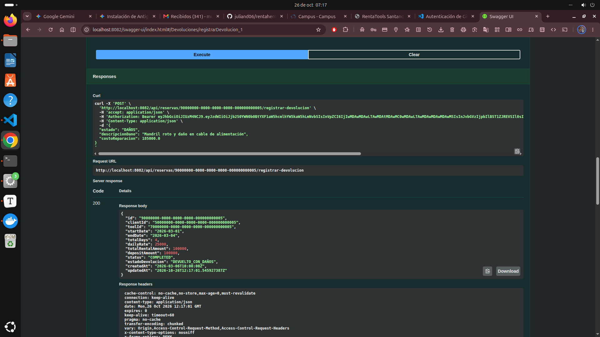
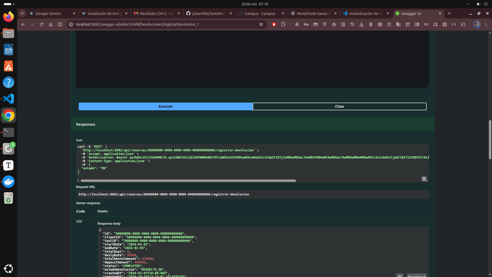
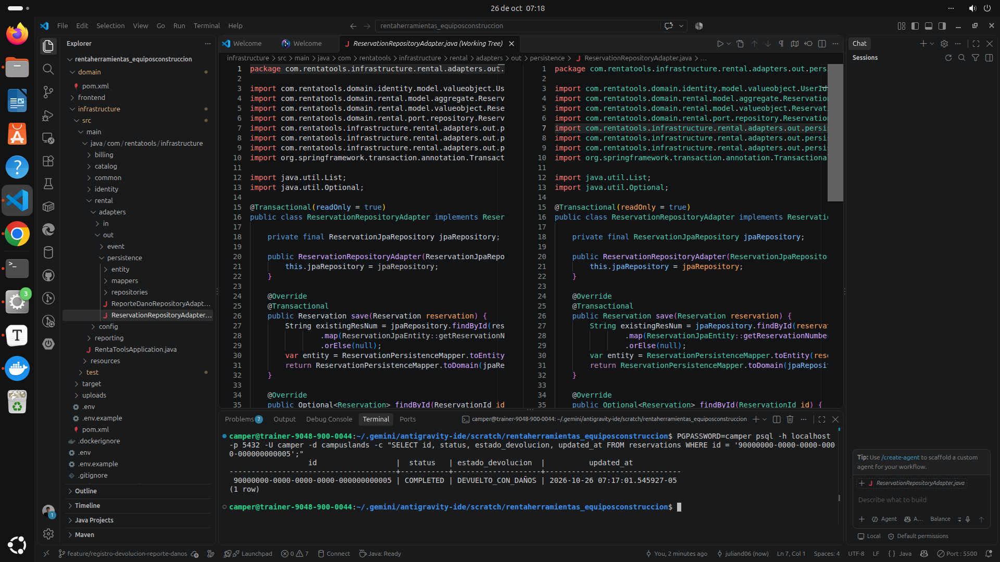
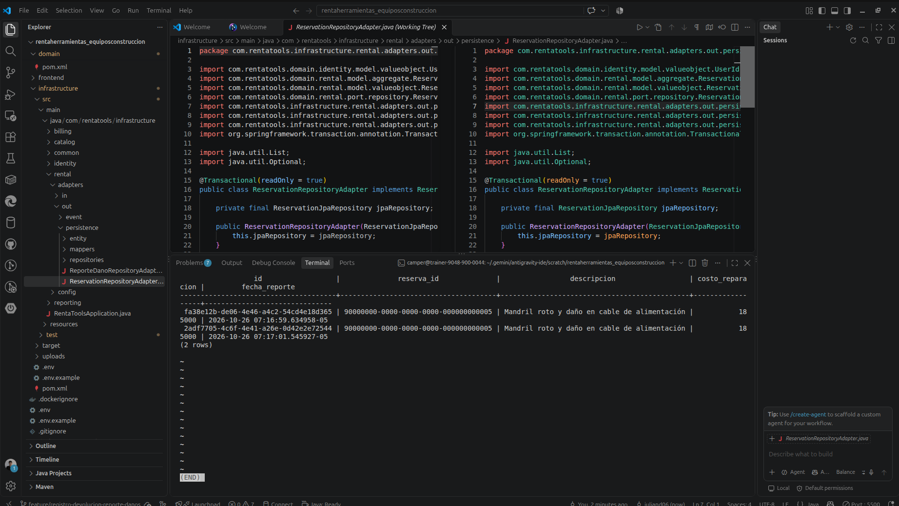

# Evidencias del Examen 1.5H: Registro de Devolución y Reporte de Daños

Este documento contiene las pruebas visuales y de persistencia solicitadas para el examen **1.5H) Registro de Devolución y Reporte de Daños** en la plataforma RentaTools Santander.

---

## 1. Llamada POST en Swagger UI con Reporte de Daños
Llamada al endpoint `POST /api/reservas/{id}/registrar-devolucion` autenticado con rol **Proveedor** (`PROVIDER`), enviando un `DevolucionDTO` con estado `"DAÑOS"`, descripción del daño y costo de reparación estimado ($185.000 COP).
- **Código de Respuesta:** `200 OK`
- **Estado de la Reserva resultante:** `DEVUELTO_CON_DAÑOS`



---

## 2. Llamada POST en Swagger UI con Devolución OK (Sin Daños)
Llamada al endpoint `POST /api/reservas/{id}/registrar-devolucion` con estado `"OK"`.
- **Código de Respuesta:** `200 OK`
- **Estado de la Reserva resultante:** `DEVUELTO_OK`



---

## 3. Base de Datos: Reserva con Estado `DEVUELTO_CON_DAÑOS`
Consulta en PostgreSQL verificando que la reserva `90000000-0000-0000-0000-000000000005` actualizó su columna `estado_devolucion` a `DEVUELTO_CON_DAÑOS`.

```sql
SELECT id, status, estado_devolucion, updated_at 
FROM reservations 
WHERE id = '90000000-0000-0000-0000-000000000005';
```



---

## 4. Base de Datos: Registro Creado en la Tabla `ReporteDano`
Consulta en PostgreSQL en la tabla `ReporteDano` verificando la creación del reporte asociado a la reserva devuelta, con los campos `descripcion`, `costo_reparacion` y `fecha_reporte`.

```sql
SELECT id, reserva_id, descripcion, costo_reparacion, fecha_reporte 
FROM ReporteDano;
```


